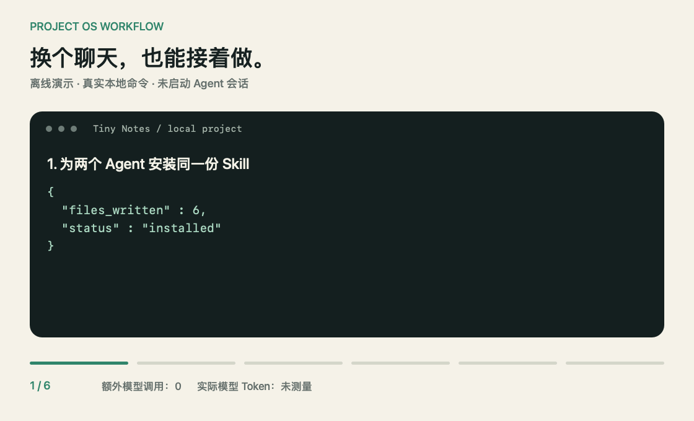

# Project OS Workflow

[中文](README.md) · **0.1.0-rc.1 / release candidate** · [MIT](LICENSE)

Give the next agent session a compact account of where the project stands, what supports that account, and what comes next. Project OS Workflow stores project state and progress receipts in a project-local SQLite database for Codex and Claude Code.

It is intended for small development projects that span sessions. The helper runs offline with Python 3.11+ and its standard library. It makes no model API calls, installs no background service, and changes no global agent configuration. Agent sessions remain subject to the chosen product's permissions and usage rules.

**Current boundary: local tests have run on macOS / Python 3.12.13 / 3.13.14. Linux is untested; Windows is currently unsupported. Fresh-session continuation tests with real Codex and Claude Code agents have NOT RUN. The synthetic demo does not establish agent compliance, and no token-saving percentage has been measured.** See [compatibility](docs/COMPATIBILITY.md), [verification](docs/VERIFICATION.md), and [release status](docs/RELEASE.md).

## Start in three steps

Get the standalone package first (the desktop application is not required):

```sh
git clone https://github.com/z-hstudio/project-os-workflow.git
cd project-os-workflow
python3 --version
```

Use Python **3.11 or newer**. If `python3` points to an older system interpreter,
replace it below with your installed newer executable, such as `python3.13`.
Without Git, choose **Code → Download ZIP** on the repository page, extract the
archive, and enter that directory.

### 1. Install into a project

From this package directory, replace the example path with your project directory:

```sh
python3 install.py install --project /path/to/project --agent both
```

Choose `codex`, `claude`, or `both`. The installer copies the canonical `skill/project-os` tree into the project's `.agents/skills/project-os` and `.claude/skills/project-os` locations as selected. It refuses to overwrite an existing target.

### 2. Initialize project state

```sh
cd /path/to/project
python3 .agents/skills/project-os/scripts/project_os.py --project . init --name 'Tiny Notes' --purpose 'Build a local notes app' --language en
```

For a Claude Code-only installation, replace `.agents` with `.claude` in the helper path. Use `--language zh` for Chinese. State lives in `.project-os/state.sqlite3`. Initialization creates `.project-os/.gitignore` containing `*` to ignore runtime data inside that directory; it does not modify the project's root `.gitignore`.

### 3. Work, then leave a receipt

Open your agent in the target project and request the `project-os` skill. For example:

> Use project-os to read the current state, check the relevant files, and continue the next step. When finished, record the actual changes, verification results, unfinished work, and next action.

You can also read the continuation context directly:

```sh
python3 .agents/skills/project-os/scripts/project_os.py --project . context --max-bytes 12288
```

This context contains project records to check. An agent report alone is not proof of completion: tests, deployments, and submissions still need their own evidence. `--max-bytes` bounds output bytes, not a fixed token count.

## Try the offline demo

From this package directory:

```sh
python3 examples/demo.py
```

The demo uses a fictional Tiny Notes project to show initialization, recording, and context retrieval. It starts no real agent.



The GIF is rendered locally from synthetic content. It is not a recording or performance test of a live Codex or Claude Code session.

## Commands and data

Run these commands from your project directory. The [record protocol](skill/project-os/references/protocol.md) defines JSON fields, revision checks, and result meanings.

```sh
python3 .agents/skills/project-os/scripts/project_os.py --project . record --input report.json
python3 .agents/skills/project-os/scripts/project_os.py --project . manual --input manual-update.json
python3 .agents/skills/project-os/scripts/project_os.py --project . history --limit 10
```

`record` stores attributed agent progress; `manual` records fields explicitly decided by the user. Automatic reports should preserve manual values. A stale receipt is saved to history only and does not change current state. Do not fetch a new revision to force an old proposal through. Get fresh context and create a new record only for genuinely new work or an explicit user edit. The protocol defines duplicate handling. For an earlier history page, use `history --limit 10 --before N`, taking `N` from the previous page's `next_before`; `null` means there is no next page.

Local storage is not a reason to publish the database. Keep credentials, private identifiers, and unnecessary source text out of reports. When an agent reads context, that content enters its session. Share only the minimum needed to explain an issue.

To uninstall, run from this package directory:

```sh
python3 install.py uninstall --project /path/to/project --agent both
```

Uninstallation preserves the user database and any modified or unowned files. Inspect its result before handling retained files; do not delete the state database to resolve an installation issue.

## Support and troubleshooting

| Symptom | Next step |
| --- | --- |
| `python3` is missing or older than 3.11 | Use Python 3.11+ with its SQLite module. This package does not install a runtime. |
| The agent does not discover the skill | Check the project root, adapter selection, and installed `SKILL.md`; start a session in that project and explicitly name `project-os`. Live discovery remains pending validation. |
| Installation reports an existing target | Inspect the existing files. If replacing them, uninstall, preserve your edits according to its result, then install again. |
| State is missing or uninitialized | Check the `--project` directory, then run `init` once. |
| Input is rejected | Read the error and [protocol](skill/project-os/references/protocol.md), then check the fields. A format correction must not become a retry that overwrites newer state. |
| A receipt is stale | It remains in history only. Stop retrying the old proposal; fresh `context` and a new record belong to new work or an explicit user edit. |
| A new session does not continue as expected | Capture a minimal agent-behavior reproduction. The synthetic demo is not a substitute for live continuation testing. |

Use the [issue template](.github/ISSUE_TEMPLATE/bug_report.md) with the package version, OS, adapter, minimal reproduction, and redacted error. Do not attach a real database, full session, credentials, or private files.

Contributors can run the local tests from this package directory:

```sh
python3 -m unittest discover -s tests -v
python3 scripts/check_package.py
```

Python 3.11 is the code's minimum requirement; the executed test environment is currently Python 3.12.13 / 3.13.14. See [verification](docs/VERIFICATION.md) for actual results and the [live canary procedure](docs/CANARY.md) for steps still awaiting session authorization.

The package checker uses no PyYAML or third-party packages. It validates this
Skill's flat metadata format, local links, Python syntax and public allowlist;
it does not establish live Agent discovery.

[Research and decisions](docs/RESEARCH.md) · [Compatibility and acceptance](docs/COMPATIBILITY.md) · [Release process](docs/RELEASE.md) · [Changelog](CHANGELOG.md) · [Contributing](CONTRIBUTING.md)
