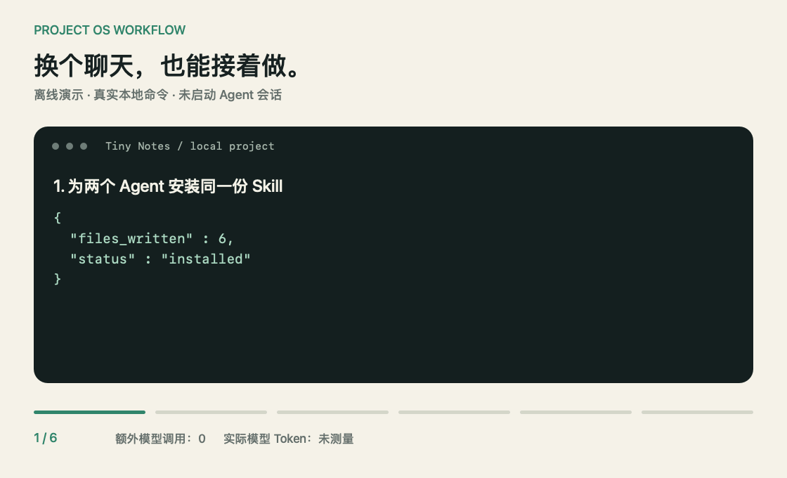

# Project OS Workflow

[English](README.en.md) · **0.1.0-rc.1 / 候选版本** · [MIT](LICENSE)

让下一次 Agent 会话知道项目做到哪里、依据是什么、接下来做什么。Project OS Workflow 把简短的项目状态和进展回执保存在项目自己的 SQLite 数据库中，供 Codex 与 Claude Code 接续工作。

它适合跨会话继续的小型开发项目。Python 3.11+ 标准库即可运行；辅助脚本离线工作，不调用模型 API，不安装后台服务，也不修改全局 Agent 配置。Agent 会话本身仍受所用产品的权限和用量规则约束。

**当前边界：本地测试运行于 macOS / Python 3.12.13 / 3.13.14；Linux 未测试，Windows 暂不支持。真实 Codex / Claude Code 新会话接续验收尚未运行。合成演示不能证明 Agent 会自动遵循流程，也没有实测 token 节省比例。** 详见[兼容性](docs/COMPATIBILITY.md)、[验证记录](docs/VERIFICATION.md)和[发布状态](docs/RELEASE.md)。

## 三步开始

先获取这个独立包（无需下载原桌面应用）：

```sh
git clone https://github.com/z-hstudio/project-os-workflow.git
cd project-os-workflow
python3 --version
```

需要 Python **3.11 或更新版本**。如果 `python3` 仍指向 macOS 自带的旧版本，
请将以下命令中的 `python3` 换成已安装的新版本入口，例如 `python3.13`。
没有 Git 时，可在仓库页面选择 **Code → Download ZIP**，解压后进入目录。

### 1. 安装到一个项目

在本包目录中运行，把示例路径换成你的项目目录：

```sh
python3 install.py install --project /path/to/project --agent both
```

`--agent` 可选 `codex`、`claude` 或 `both`。安装器把同一份 `skill/project-os` 分别复制到项目的 `.agents/skills/project-os` 和 `.claude/skills/project-os`；已有目标不会被覆盖。

### 2. 初始化项目状态

```sh
cd /path/to/project
python3 .agents/skills/project-os/scripts/project_os.py --project . init --name 'Tiny Notes' --purpose '构建一个本地笔记应用' --language zh
```

只安装 Claude Code 时，将脚本路径中的 `.agents` 换成 `.claude`。使用 `--language en` 可选择英文。状态位于 `.project-os/state.sqlite3`；初始化创建内容为 `*` 的 `.project-os/.gitignore` 来忽略该目录内的运行数据，不修改项目根目录的 `.gitignore`。

### 3. 开始工作，结束时留下一条回执

在目标项目中打开 Agent，让它使用 `project-os` Skill，例如：

> 使用 project-os 读取当前状态，核对相关文件后继续下一步。结束时记录实际改动、验证结果、未完成项和下一步。

也可以直接查看接续上下文：

```sh
python3 .agents/skills/project-os/scripts/project_os.py --project . context --max-bytes 12288
```

上下文给出待核对的项目记录；Agent 的报告本身不是完成证明。检查、部署或提交等结果仍应以相应证据为准。`--max-bytes` 限制输出字节数，不代表固定 token 数。

## 看一个离线演示

在本包目录运行：

```sh
python3 examples/demo.py
```

演示使用虚构的 Tiny Notes 项目展示初始化、记录与读取，不启动真实 Agent。



GIF 是本地合成画面，不是真实 Codex / Claude Code 会话录屏或效果测试。

## 日常命令与数据

在项目目录运行以下命令。输入 JSON 的字段、版本检查和结果含义以[记录协议](skill/project-os/references/protocol.md)为准。

```sh
python3 .agents/skills/project-os/scripts/project_os.py --project . record --input report.json
python3 .agents/skills/project-os/scripts/project_os.py --project . manual --input manual-update.json
python3 .agents/skills/project-os/scripts/project_os.py --project . history --limit 10
```

`record` 保存带来源的 Agent 进展；`manual` 用于用户明确决定的字段。自动记录应保留用户手动值。旧版本回执只写入历史，不修改当前状态；不要取得新版本号后强行重试旧提案。只有实际的新任务或用户明确要求的修改，才读取最新上下文并建立新记录。重复提交规则见协议。较早历史可用 `history --limit 10 --before N` 获取，`N` 使用上一页返回的 `next_before`；该值为 `null` 时没有下一页。

数据库保存在本地不等于适合公开。提交进展前避免写入密钥、私人标识和不必要的原文；使用 Agent 时，读取的上下文会进入该 Agent 的会话。只读分享所需的最小内容。

要卸载，在本包目录运行：

```sh
python3 install.py uninstall --project /path/to/project --agent both
```

卸载保留用户数据库，以及修改过或不属于安装器的文件。先检查卸载结果，再决定如何处理保留项；不要为解决安装问题删除状态数据库。

## 支持与排查

| 情况 | 下一步 |
| --- | --- |
| 找不到 `python3`，或版本低于 3.11 | 使用带 SQLite 模块的 Python 3.11+；本包不会替你安装运行环境。 |
| Agent 找不到 Skill | 核对项目根目录、所选适配器和对应 `SKILL.md`；在该项目中新开会话并明确点名 `project-os`。真实发现行为仍待验收。 |
| 安装提示目标已存在 | 检查现有内容；需要替换时先按卸载结果保留自己的改动，再重新安装。 |
| 提示未初始化或没有状态 | 确认 `--project` 指向正确目录，再执行一次 `init`。 |
| 输入被拒绝 | 阅读错误和[协议](skill/project-os/references/protocol.md)，核对输入字段；不要把格式修正变成覆盖新状态的重试。 |
| 返回旧版本结果 | 回执只保留在历史中。停止重试旧提案；新任务或用户明确修改才需要最新 `context` 和新记录。 |
| 新会话没有按计划继续 | 这是需要复现的 Agent 行为问题；合成演示不能替代真实接续验收。 |

报告问题时使用[问题模板](.github/ISSUE_TEMPLATE/bug_report.md)，提供版本、操作系统、适配器、最小复现和脱敏后的错误。不要上传真实数据库、完整会话、凭据或私人文件。

贡献者可在本包目录运行本地测试：

```sh
python3 -m unittest discover -s tests -v
python3 scripts/check_package.py
```

Python 3.11 是代码的最低要求，目前执行过的测试环境为 Python 3.12.13 / 3.13.14；具体结果以[验证记录](docs/VERIFICATION.md)为准。[真实会话验收说明](docs/CANARY.md)列出仍待授权运行的步骤。

包检查无需 PyYAML 或其他第三方库；它核对当前 Skill 的固定格式、文档链接、
Python 语法和公开文件白名单，不冒充真实 Agent 加载测试。

[研究与取舍](docs/RESEARCH.md) · [兼容性与验收范围](docs/COMPATIBILITY.md) · [发布流程](docs/RELEASE.md) · [更新记录](CHANGELOG.md) · [贡献说明](CONTRIBUTING.md)
